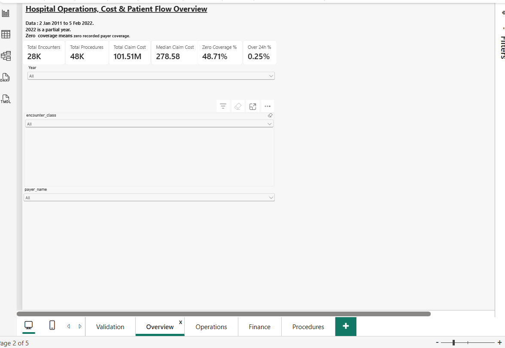
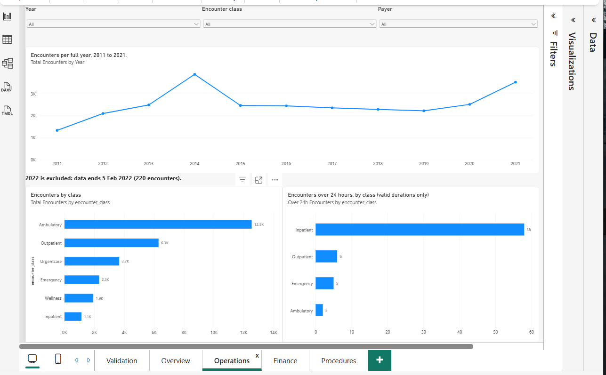
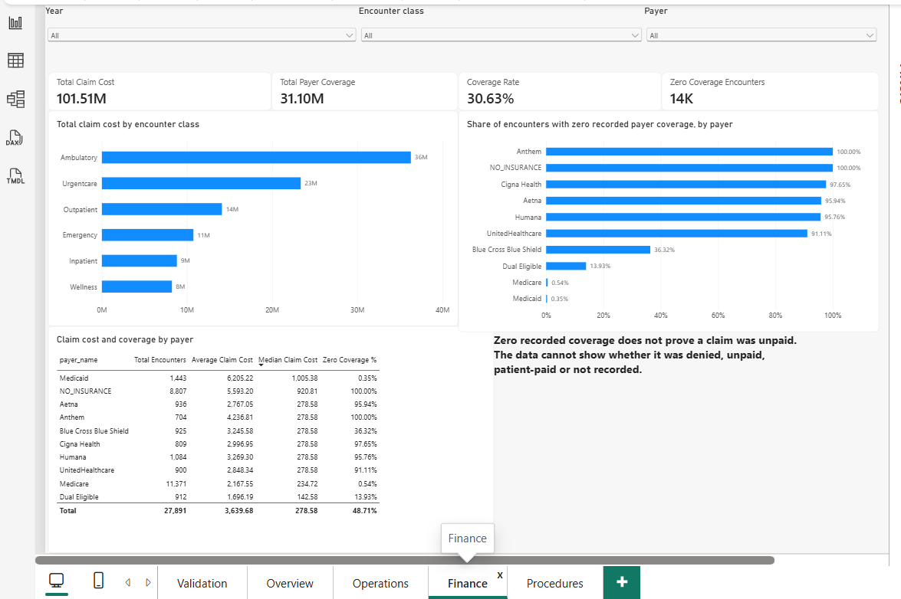
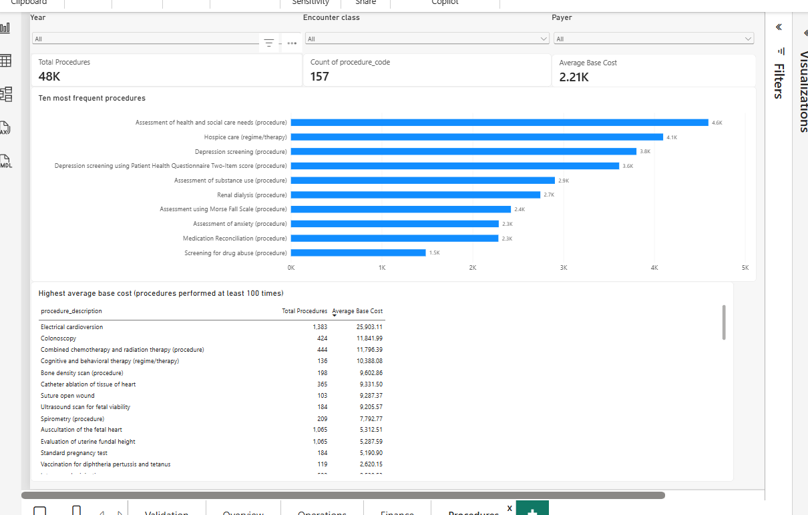
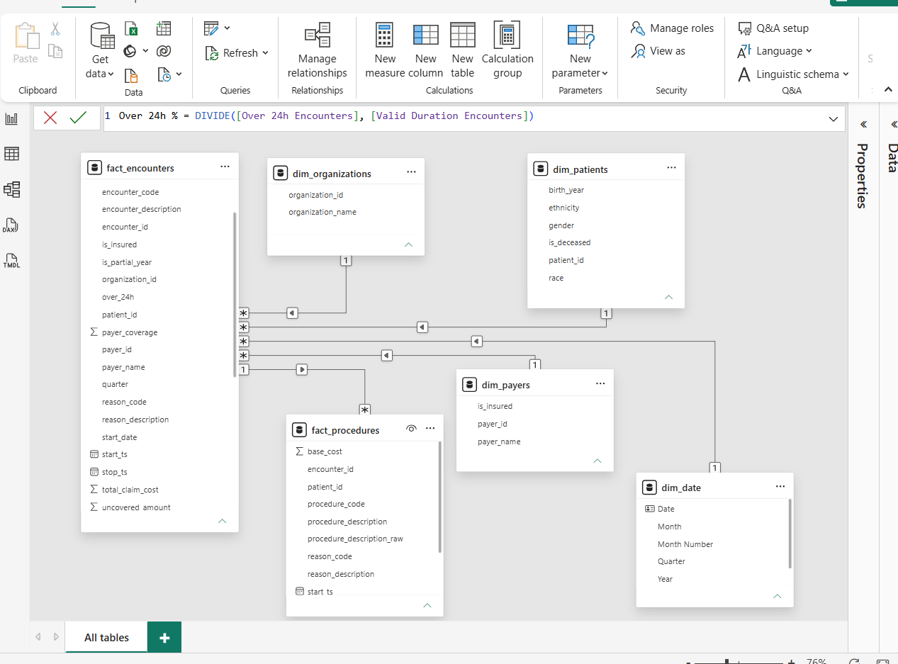

# Hospital Operations, Cost & Patient Flow Intelligence

An interactive Power BI dashboard, supported by Python data preparation and independent validation, that shows how a hospital's encounters, costs, payer coverage and procedures have behaved between 2011 and early 2022.

Built for the **AnalystLab Africa Experience Lab, Week 3** (Track A: Data Analytics). `#AnalystLabAfrica`



---

## The business problem

A healthcare organisation wants a clearer view of its hospital operations: how many encounters it handles, what kinds they are, what they cost, who pays, and which procedures are most common.

The dashboard is written for two users:

| User | Decisions the dashboard supports |
|---|---|
| **Hospital operations manager** | Where to place staff and capacity, which services are growing, which procedures drive workload |
| **Finance / revenue manager** | Which payers and encounter classes to review for billing and coverage gaps, where cost is concentrated |

## Key findings

| # | Finding |
|---|---|
| 1 | **27,891 encounters** and **47,701 procedures** between 2 Jan 2011 and 5 Feb 2022, with total claim cost of **101.5 million**. |
| 2 | Volume peaked in 2014 (3,885) and again in 2021 (3,530), with a plateau between. 2022 is a partial year. |
| 3 | **Urgent care** is 13.1% of encounters but 23.0% of claim cost. |
| 4 | **48.7% of encounters show zero recorded payer coverage.** Medicare and Medicaid are under 1%, while five commercial payers are above 90%. |
| 5 | Uninsured encounters are 31.6% of volume but **48.5% of claim cost**. |
| 6 | Only **0.25%** of encounters last over 24 hours, and 82% of those are inpatient. |
| 7 | Costs are heavily skewed: the median claim is 278.58 against a mean of 3,639.68, and the top 5% of encounters carry 44.6% of cost. |

The full write-up, with five recommendations, is in [`docs/04_executive_summary.md`](docs/04_executive_summary.md).

## Dashboard pages

| Page | What it shows |
|---|---|
| **Overview** | Six headline KPIs |
| **Operations** | Encounters per year, encounters by class, long stays (over 24 hours) by class |
| **Finance** | Claim cost by class, payer coverage, zero recorded coverage by payer, cost by payer |
| **Procedures** | Ten most frequent procedures, highest average base cost (procedures performed at least 100 times) |

Year, encounter class and payer filters are synced across all pages.

| Operations | Finance |
|---|---|
|  |  |



## Data model



One fact table (`fact_encounters`) linked to `dim_patients`, `dim_payers`, `dim_organizations` and `dim_date`, with `fact_procedures` linked by `encounter_id`. All relationships are one-to-many with single-direction filtering.

## Data quality decisions

The data was inspected before any analysis, and nothing was deleted. Every issue and the decision taken is documented in [`docs/01_data_quality_assessment.md`](docs/01_data_quality_assessment.md). The main ones:

- **4 encounters lasting more than a year** are excluded from duration measures only, and kept everywhere else.
- **2022 is a partial year** (data ends 5 Feb) and is left out of the trend line, but kept in all totals.
- **Zero payer coverage** is shown as "zero recorded coverage", because the data cannot show whether a claim was denied, unpaid, patient-paid or not recorded.
- **Procedures are grouped by code**, with one standard description per code.
- **Blank reason fields are left blank**, with no imputation.

## Validation

| Criterion | Evidence |
|---|---|
| **SC1:** dashboard numbers match an independent calculation | [`src/validate_kpis.py`](src/validate_kpis.py) recalculates 13 KPIs from the raw CSV files. Output in [`docs/validation_independent_check.txt`](docs/validation_independent_check.txt). |
| **SC2:** filters work and the parts add up to the whole | Screenshots in [`dashboard/screenshots/`](dashboard/screenshots/) (`sc2_*.png`) |
| **SC3:** every KPI is reproducible | [`docs/kpi_definitions.md`](docs/kpi_definitions.md) |

The success criteria are defined in [`docs/03_success_criteria.md`](docs/03_success_criteria.md).

## Repository structure

```
.
├── README.md
├── requirements.txt
├── dashboard/
│   └── screenshots/              Dashboard pages and validation screenshots
├── docs/
│   ├── 01_data_quality_assessment.md
│   ├── 02_problem_statement.md
│   ├── 03_success_criteria.md
│   ├── 04_executive_summary.md
│   ├── kpi_definitions.md
│   └── validation_independent_check.txt
└── src/
    ├── prepare_data.py           Builds clean tables from the raw CSVs
    └── validate_kpis.py          Independent KPI check from the raw CSVs
```

The data files and the Power BI file (`.pbix`) are **not in this repository** (see Privacy below).

## How to reproduce

**1. Clone and set up the environment**

```bash
git clone git@github.com:joenzau41-png/week3-hospital-operations.git
cd week3-hospital-operations
python -m venv .venv
source .venv/Scripts/activate      # Windows Git Bash. On macOS/Linux: source .venv/bin/activate
pip install -r requirements.txt
```

**2. Add the data**

Place the six files from the AnalystLab Africa dataset pack in `data/raw/`: `encounters.csv`, `patients.csv`, `procedures.csv`, `payers.csv`, `organizations.csv` and `data_dictionary.csv`.

**3. Prepare the data**

```bash
python src/prepare_data.py
```

This writes five clean tables to `data/processed/` and stops with an error if a row count, key or total changes, or if a personal column appears in an output. Expected output includes `fact_encounters 27,891` rows and `zero_recorded_coverage : 13,586`.

**4. Check the KPIs independently**

```bash
python src/validate_kpis.py
```

**5. Rebuild the dashboard**

In Power BI Desktop, load the five CSVs from `data/processed/`, create the relationships described above, add a date table, and create the measures defined in [`docs/kpi_definitions.md`](docs/kpi_definitions.md).

<details>
<summary>Date table (DAX)</summary>

```
dim_date =
ADDCOLUMNS(
    CALENDAR(
        DATE(YEAR(MIN(fact_encounters[start_date])), 1, 1),
        DATE(YEAR(MAX(fact_encounters[start_date])), 12, 31)
    ),
    "Year", YEAR([Date]),
    "Quarter", "Q" & QUARTER([Date]),
    "Month Number", MONTH([Date]),
    "Month", FORMAT([Date], "MMM"),
    "Year-Month", FORMAT([Date], "YYYY-MM")
)
```

Mark it as the date table, and relate `dim_date[Date]` to `fact_encounters[start_date]`.

</details>

## Privacy and responsible use

- Patient name and address columns are never loaded. Birth date is reduced to birth year.
- Raw data, processed data and the `.pbix` file are excluded from the repository through `.gitignore`.
- The dashboard describes recorded data only. It makes no clinical claims and no treatment recommendations.

## Limitations

- One organisation only, so findings do not generalise.
- Currency and the exact meaning of "total claim cost" are not stated in the data dictionary.
- Zero recorded coverage is ambiguous (see above).
- No clinical outcome data is available.
- The same procedure can have different base costs, and base cost is not necessarily what was charged or paid.

## Tools

Power BI Desktop (Power Query, DAX), Python 3, pandas, Git and GitHub.

## Acknowledgements

Dataset pack and assignment brief provided by **AnalystLab Africa**.

## Author

**Joel Nzau**. GitHub: [joenzau41-png](https://github.com/joenzau41-png)
            LinkedIn: [Joel (Kaloki) Nzau](www.linkedin.com/in/nzau-joel)