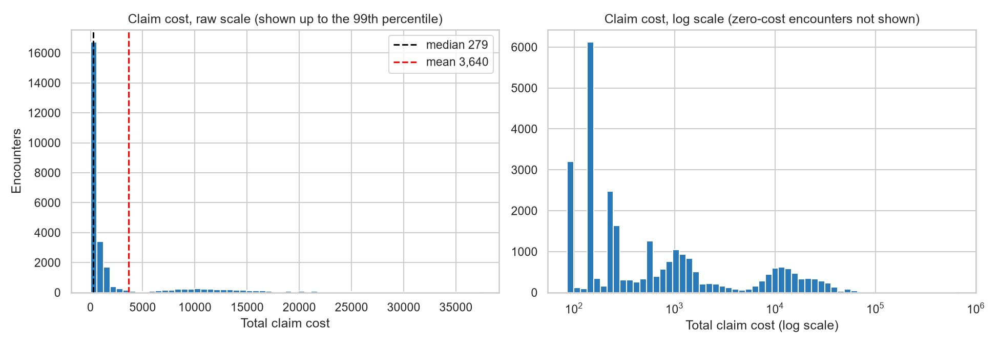
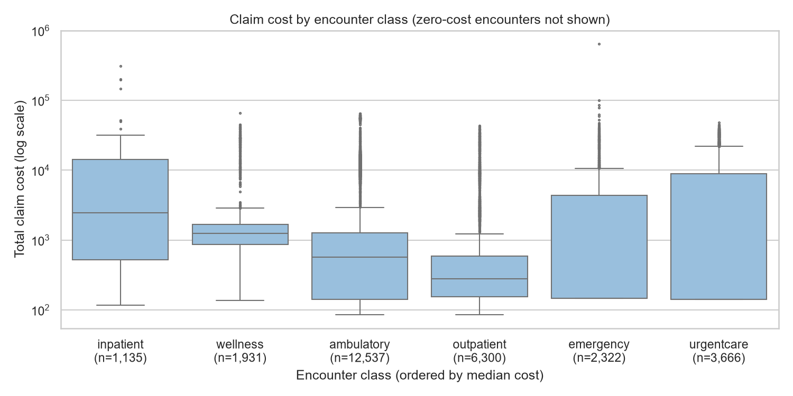
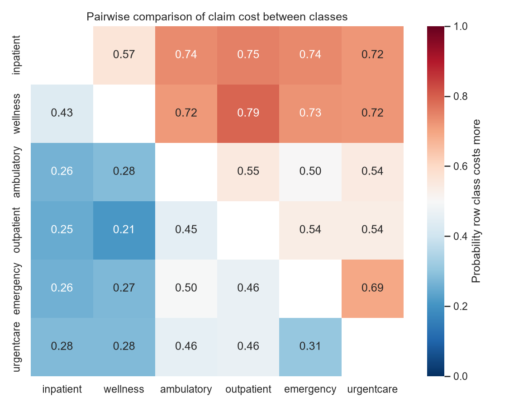
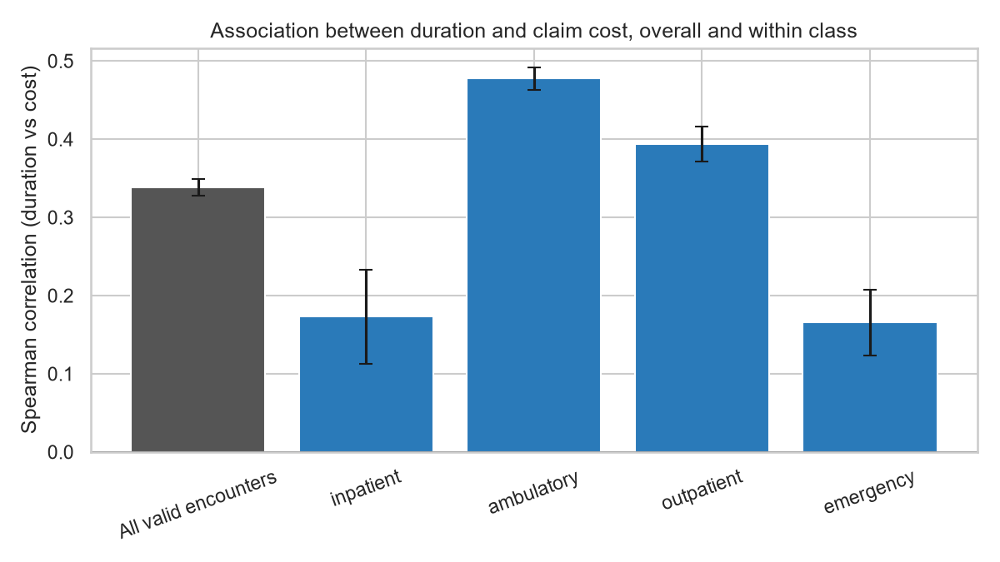

# Statistical Analysis Report

**Project:** Hospital Operations, Cost & Patient Flow Intelligence
**Programme:** AnalystLab Africa Experience Lab, Week 3 (Track B: Data Science)
**Author:** Joel nzau
**Notebook:** [`notebooks/track_b_analysis.ipynb`](../notebooks/track_b_analysis.ipynb)
**Related:** [01_data_quality_assessment.md](01_data_quality_assessment.md), [04_executive_summary.md](04_executive_summary.md)

---

## 1. Research question and objectives

**Research question:** How do recorded encounter claim costs vary across encounter classes, and are they associated with encounter duration?

**Objectives**

1. Describe the distribution of claim cost and duration, and identify what makes them hard to analyse.
2. Test whether claim cost differs across the six encounter classes (H1).
3. Test whether claim cost is associated with encounter duration (H2).
4. Test whether claim cost differs between insured and uninsured encounters (H3).
5. State clearly what the results can and cannot establish.

**Why it matters:** claim cost is the main financial measure for each encounter. Understanding how it varies helps operations and finance managers decide where to review cost.

## 2. Data preparation approach

The analysis uses `fact_encounters` (27,891 encounters, 974 patients, 2 January 2011 to 5 February 2022), prepared by `src/prepare_data.py` from the raw CSV files. Patient names and addresses are never loaded.

| Variable | Role |
|---|---|
| `total_claim_cost` | Outcome (continuous, never negative) |
| `encounter_class` | Explanatory variable for H1 (6 groups) |
| `duration_hours` | Explanatory variable for H2 (valid durations only, 27,887 rows) |
| `is_insured` | Explanatory variable for H3 (payer `NO_INSURANCE` versus any other) |

Data decisions (see `01_data_quality_assessment.md`): four encounters with durations over one year are excluded from the duration analysis only. Zero values are kept. Nothing is imputed. Rows are never deleted.

## 3. Data-quality summary

| Check | Result | Treatment |
|---|---|---|
| Missing values | None in the variables used | Nothing to impute |
| Duplicate encounters | 0 | |
| Negative costs | 0 | |
| Payer coverage above claim cost | 0 | |
| Zero-cost encounters | 89 | Kept and flagged |
| Invalid durations (over one year) | 4 | Excluded from H2 only |
| Partial final year (2022) | 220 encounters | Kept. Year is not used in any test |
| Repeated patients | Median 14 encounters per patient. Maximum 1,381 (5.0% of rows). Busiest 10 patients: 20.6% | Sensitivity analyses |
| Repeated values | 13,529 distinct costs among 27,891 encounters. 69% of durations are exactly 15 minutes | Rank-based methods with average ranks |

## 4. Exploratory findings

**Claim cost is extremely skewed and clustered.** The mean (3,639.68) is 13 times the median (278.58). Skewness is 16.27. On a log scale the distribution has several separate peaks, so it looks like a mixture of encounter types with typical charges, and it is not normal even after a log transform.



**Cost differs visibly by class.** Median cost is highest for inpatient (2,355.59) and wellness (1,231.44), and lowest for emergency (146.18) and urgent care (142.58). Emergency and urgent care also contain a minority of very expensive encounters, so their means (4,630 and 6,369) are far above their medians.



**A small share of encounters carries most of the cost.** The top 1% of encounters carry 14.5% of cost, the top 5% carry 44.6%, and the top 10% carry 66.6%. These values are not errors, so they are kept, and rank-based methods are used.

**Duration is largely set by class.** 69.3% of valid encounters last exactly 15 minutes. Wellness and urgent care are 100% at 15 minutes, emergency begins at exactly 1 hour, and inpatient at exactly 24 hours. This makes confounding between class and duration a central concern for H2.

**Patients repeat heavily.** One patient has 1,381 encounters. Encounters from the same patient are not independent, which affects every test (see Section 7).

**Uninsured encounters cost more.** Median 920.81 against 236.98 for insured encounters, with the same direction in every class.

Further figures: [duration](figures/fig03_duration_distribution.png), [duration against cost](figures/fig04_duration_vs_cost.png), [encounters per patient](figures/fig05_encounters_per_patient.png), [insured against uninsured](figures/fig06_cost_insured_vs_uninsured.png).

## 5. Hypotheses and statistical methods

All tests use alpha = 0.05. Very small p-values underflow to zero and are written as "< 1e-300". Because the sample is large, results are judged by effect size as well as p-value.

| | H1 | H2 | H3 |
|---|---|---|---|
| **H0** | Claim cost has the same distribution in all six classes | No monotonic association between duration and cost (rho = 0) | Claim cost has the same distribution for insured and uninsured encounters |
| **H1 (alternative)** | At least one class differs | Association exists (rho is not 0) | The groups differ |
| **Method** | Kruskal-Wallis, epsilon-squared effect size, then pairwise Mann-Whitney with Holm correction | Spearman rank correlation, approximate 95% CI | Mann-Whitney U, probability of superiority, then within each class |
| **Why this method** | ANOVA assumptions fail: normality is rejected (Shapiro-Wilk W = 0.459 on raw cost, 0.887 after log transform) and spread differs across classes (Levene 159.2) | Both variables are heavily skewed. Ranks limit the influence of extremes and need no straight line | Two independent groups, very skewed outcome |
| **Key assumptions** | Independent observations (only partly true), rankable outcome | Paired values, monotonic relationship, independence (partly), ties handled by average ranks | Independence (partly), rankable outcome |

## 6. Results and interpretation

### H1: claim cost differs across encounter classes

- Kruskal-Wallis H = 2,025.2 (5 df), p < 1e-300. **H0 rejected.**
- Effect size epsilon-squared = **0.073**, a medium effect: class accounts for roughly 7% of the variation in cost ranks.
- Pairwise (Holm-corrected): **14 of 15 pairs differ.** The only exception is ambulatory against emergency (probability 0.503, p = 0.64).
- Largest contrasts: an inpatient encounter costs more than an outpatient one 75% of the time and more than an urgent care one 72% of the time. A wellness encounter costs more than an outpatient one 79% of the time.



**Plain language:** the type of encounter matters for cost, but it leaves about 93% of the variation unexplained, so class alone does not predict the cost of an individual encounter.

**Sensitivity to repeated patients.** Without the 10 busiest patients: H = 2,204.7, epsilon-squared = 0.100. With one value per patient and class (2,393 values): H = 363.0, p = 2.72e-76, epsilon-squared = 0.152. The conclusion holds. The ranking of classes does not: emergency has a median of 146.18 across encounters but 2,757.73 across patients, and urgent care 142.58 against 278.58. A minority of frequent patients appears to contribute many low-cost encounters in some classes. Reports should say whether encounters or patients are the unit.

### H2: claim cost is associated with encounter duration

- Overall Spearman rho = **0.339** (95% CI 0.327 to 0.349), p < 1e-300. **H0 rejected.** A medium association.
- Within classes the association persists: ambulatory 0.478, outpatient 0.394, inpatient 0.173, emergency 0.166. The class-adjusted rank correlation is 0.392.
- Wellness and urgent care cannot be tested because every encounter lasts exactly 15 minutes.



**Plain language:** longer encounters tend to cost more, and this is not only because of class. The association is strongest where durations vary most (ambulatory, outpatient). About 11% of the variation in cost ranks is shared with duration, so duration alone is a weak basis for predicting an individual cost.

### H3: claim cost differs between insured and uninsured encounters

- Uninsured median 920.81, insured median 236.98. Mann-Whitney U = 104,844,580, p = 2.45e-244. **H0 rejected.**
- Probability that a random uninsured encounter costs more than a random insured one: **0.624** (small to medium).
- Within every class the uninsured group is higher (probabilities 0.57 to 0.74), all significant after Holm correction. The gap is largest in urgent care (0.735) and emergency (0.698).

**Plain language:** uninsured encounters tend to be more expensive, in every class, so this is not only a matter of class mix. The data cannot say why.

### Summary

| Hypothesis | Test | Statistic | p-value | Effect size | Decision |
|---|---|---|---|---|---|
| H1 cost differs by class | Kruskal-Wallis | H = 2,025.2 | < 1e-300 | epsilon-squared 0.073 (medium) | Reject H0 |
| H2 cost associated with duration | Spearman | rho = 0.339 | < 1e-300 | rho 0.34, CI (0.33, 0.35) (medium) | Reject H0 |
| H3 insured and uninsured differ | Mann-Whitney U | U = 104,844,580 | 2.45e-244 | probability 0.624 (small to medium) | Reject H0 |

## 7. Limitations

- **Repeated patients.** Tests assume independent observations, which is not true here. P-values are too optimistic. Two sensitivity analyses were run. H1 held in both, but the ranking of classes changed.
- **Unequal group sizes** (1,135 to 12,537). Pairwise tests have more power for large classes.
- **Many tied values.** Reduces the information in cost and duration. Average ranks were used.
- **Confounding.** There is no diagnosis, severity, services delivered or age in the analysis. Differences by class, duration and insurance may reflect things not measured. H2 and H3 were also tested within class.
- **Association, not causation.** No result shows that class, duration or insurance causes cost.
- **Large sample.** Tiny differences give tiny p-values, so effect sizes are reported and used to judge importance.
- **Multiple testing.** Pairwise comparisons were Holm-corrected. The three main hypotheses are separate questions and are not corrected, though all are very strongly significant.
- **Extreme values and zeros.** Kept in all tests. Zeros cannot be shown on log charts.
- **Duration measure.** Some durations of several months pass the one-year rule and may be recording artefacts. Rank-based methods limit their influence.
- **One organisation, provenance not stated.** Findings apply to this dataset only.

No clinical claims are made.

## 8. Findings and recommendations

**Findings**

1. Claim cost differs by encounter class (medium effect), and the result is robust to repeated patients, though the class ranking depends on the unit of analysis.
2. Longer encounters tend to cost more (medium association), including within classes.
3. Uninsured encounters tend to cost more than insured ones in every class (small to medium effect).
4. Costs are very skewed: the mean is 13 times the median and the top 5% of encounters carry 44.6% of cost.

**Recommendations**

| # | Recommendation | Limitation |
|---|---|---|
| 1 | Report cost as medians and distributions, never means alone, and state whether the unit is encounters or patients | Medians hide the expensive minority, so also report the upper range |
| 2 | Compare cost across years, payers or sites only after accounting for encounter class mix | Class explains only about 7% of rank variation |
| 3 | Review billing and cost recording for uninsured encounters in urgent care and emergency, where the gap is largest | Cannot show cause. Case mix and recording differences are possible |
| 4 | Before building any cost prediction model, add diagnosis or severity, services delivered and claim status | Requires a richer data feed |
| 5 | Treat duration as a descriptor of class, and review unusually long ambulatory and outpatient encounters | Duration and cost may both follow from services delivered |

## 9. Reproducing the analysis

1. Clone the repository, then create and activate the environment:
   ```
   python -m venv .venv
   source .venv/Scripts/activate      # Windows Git Bash. macOS/Linux: source .venv/bin/activate
   pip install -r requirements.txt
   ```
2. Place the six AnalystLab Africa dataset files in `data/raw/`.
3. Build the cleaned tables: `python src/prepare_data.py`
4. Open `notebooks/track_b_analysis.ipynb`, select the `.venv` kernel, and choose **Run All**. Figures are written to `docs/figures/`.

A fixed random seed (42) is used for all random sampling, so repeated runs give identical results. Library versions are printed at the top of the notebook.
